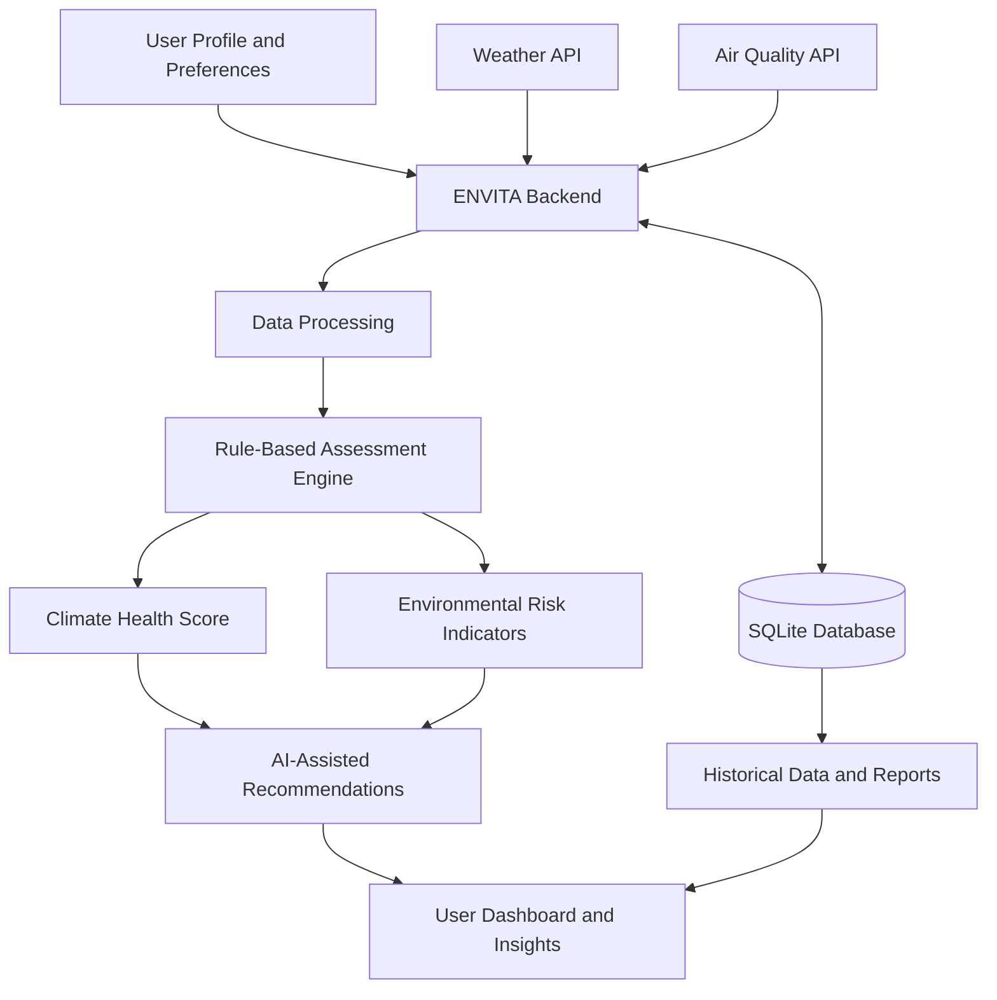

# 🌿 ENVITA — Personalized Climate Health Resilience Platform

> **Understand your environment. Protect your well-being. Build climate resilience.**

ENVITA is a personalized climate-health resilience platform that combines environmental data, air-quality indicators, user profiles, and AI-assisted guidance to help people understand how changing environmental conditions may affect their well-being.

The platform transforms weather and air-quality information into a personalized Climate Health Score, practical precautions, environmental alerts, and periodic health-resilience insights.

**Built for:** Parul University Environment Hackathon 2026  
**Theme:** Designing Sustainable Futures in a Digital Age

---

## 📌 Table of Contents

- [Overview](#-overview)
- [Problem Statement](#-problem-statement)
- [Our Solution](#-our-solution)
- [Key Features](#-key-features)
- [How ENVITA Works](#-how-envita-works)
- [Climate Health Score](#-climate-health-score)
- [Technology Stack](#-technology-stack)
- [System Architecture](#-system-architecture)
- [Project Structure](#-project-structure)
- [Getting Started](#-getting-started)
- [Environment Configuration](#-environment-configuration)
- [External API Integrations](#-external-api-integrations)
- [Example Use Case](#-example-use-case)
- [Future Enhancements](#-future-enhancements)
- [Limitations and Disclaimer](#-limitations-and-disclaimer)
- [Contributing](#-contributing)
- [Author](#-author)

## 🌍 Overview

Climate change, rising temperatures, air pollution, and unpredictable weather can create environmental conditions that affect human comfort and well-being. However, environmental data is often presented as raw measurements that are difficult for individuals to interpret in the context of their own circumstances.

ENVITA bridges this gap by bringing together environmental indicators and user-specific information to provide accessible, personalized climate-health insights.

The platform is designed to make environmental information more actionable by translating weather and air-quality data into understandable risk indicators and practical recommendations.

## ❗ Problem Statement

Environmental information is widely available, but several challenges remain:

- **Fragmented environmental data:** Weather and air-quality information are often accessed through separate platforms.
- **Limited personalization:** General environmental alerts may not account for differences in age, occupation, lifestyle, and user-reported sensitivities.
- **Difficult interpretation:** Measurements such as AQI, PM2.5, UV index, and humidity can be difficult to interpret without context.
- **Lack of actionable guidance:** Users need practical precautions, not just environmental readings.
- **Limited long-term awareness:** Without periodic summaries, users may struggle to recognize environmental patterns and adjust their routines.

## 💡 Our Solution

ENVITA combines environmental monitoring with a rule-based assessment engine and AI-assisted recommendations.

The platform collects environmental measurements, considers relevant user-profile information, evaluates conditions using predefined scoring rules, and presents personalized insights in an accessible format.

Its core objective is to help users make more informed everyday decisions based on environmental conditions.

## ✨ Key Features

### 🌤️ Environmental Monitoring

Retrieve and present environmental information through external APIs, including:

- Temperature
- Relative humidity
- UV index
- Wind speed
- Air Quality Index (AQI)
- Fine particulate matter (PM2.5)
- Coarse particulate matter (PM10)

### 👤 Personalized User Profiles

Use user-provided information to contextualize environmental assessments, including relevant factors such as:

- Age group
- Occupation
- Lifestyle
- Health sensitivities

These details help the assessment engine apply relevant predefined rules when generating personalized insights.

### 📊 Climate Health Score

ENVITA calculates a Climate Health Score using a predefined, rule-based scoring methodology that combines selected environmental measurements and user-profile factors.

The score provides an accessible summary of the conditions evaluated by the platform.

### 🤖 AI-Assisted Recommendations

Google Gemini API integration can be used to generate clear, contextual explanations and practical precautions based on the available environmental information and assessment results.

The scoring engine and generative AI component serve different purposes: the rule-based engine calculates the score, while the AI component helps communicate relevant insights.

### 🚨 Environmental Alerts

The platform is designed to help users recognize potentially concerning environmental conditions and receive relevant precautions based on configured thresholds and assessment rules.

### 📅 Periodic Reports and Insights

Weekly reporting is part of the platform's intended functionality, helping users review environmental conditions and their associated assessments over time.

### 📚 Modular Backend Architecture

The application separates routes, services, configuration, utility functions, templates, and supporting components to make the codebase easier to maintain and extend.

---

## 🔄 How ENVITA Works

The application follows a data-to-insight workflow.

1. **Collect user information:** Gather relevant profile details and user-reported sensitivities.
2. **Retrieve environmental data:** Obtain available weather and air-quality measurements from integrated services.
3. **Process the inputs:** Organize the retrieved measurements and relevant profile factors for assessment.
4. **Calculate the Climate Health Score:** Apply predefined scoring rules and weights.
5. **Generate contextual insights:** Use the assessment results to support personalized explanations and recommendations.
6. **Present the results:** Display environmental information, the calculated score, and relevant precautions through the application interface.
7. **Support ongoing awareness:** Use available historical information to support alerts and periodic reporting.

### High-Level Workflow



*This diagram represents the conceptual workflow; individual integrations and persistence behaviour depend on the implemented modules.*

## 🧮 Climate Health Score

The Climate Health Score is a central component of ENVITA.

Rather than relying on a trained machine-learning model, the platform uses predefined rules and weights to evaluate selected environmental and user-profile factors.

### Assessment inputs

| Category | Example inputs |
|---|---|
| Weather | Temperature, humidity, UV index, wind speed |
| Air quality | AQI, PM2.5, PM10 |
| User profile | Age group, occupation, lifestyle |
| User-reported sensitivities | Relevant environmental or health sensitivities |

### Scoring methodology

At a high level, the assessment engine evaluates the available inputs using configured rules and weights, then produces a Climate Health Score.

The score is intended to summarize the environmental conditions assessed by the application. Its exact calculation, thresholds, and interpretation depend on the scoring rules implemented in the codebase.

**Important:** The score is a rule-based environmental assessment indicator, not a clinically validated health measurement or a prediction of whether someone will develop a disease.

---

## 🛠️ Technology Stack

| Technology | Purpose |
|---|---|
| Python | Core application logic and data processing |
| Flask | Backend web framework and request handling |
| SQLite | Relational data persistence |
| HTML | Application page structure |
| CSS | Styling and presentation |
| JavaScript | Client-side interactivity |
| Pandas | Tabular data processing where used |
| NumPy | Numerical operations where used |
| OpenWeather API | Weather and atmospheric measurements |
| OpenAQ API | Air-quality measurements where available |
| Google Gemini API | AI-assisted explanations and recommendations |
| Git and GitHub | Version control and source-code hosting |

*The table describes the project stack and intended responsibilities; confirm individual package and API usage against the current implementation before treating every item as an active dependency.*

---

## 🏗️ System Architecture

ENVITA follows a modular Flask application structure.

- **Application entry point:** Initializes the web application and connects the relevant components.
- **Routes:** Handle incoming requests and coordinate application workflows.
- **Services:** Encapsulate business logic, environmental data retrieval, scoring, and other operations.
- **Models and data modules:** Support data organization and application-specific processing.
- **Utilities:** Provide reusable helper functions.
- **Prompts:** Organize prompt-related resources for AI-assisted functionality.
- **Templates and static assets:** Support the user interface and client-side resources.
- **Configuration:** Centralizes application settings and integration configuration.
- **Database:** Supports persistent application data where implemented.

This separation helps keep request handling, business logic, and presentation concerns organized as the application evolves.

## 📁 Project Structure

The repository includes the following main directories and files:

```text
ENVITA/
├── app.py
├── config.py
├── requirements.txt
├── .env
├── README.md
├── data/
├── databasae/
├── docs/
├── models/
├── prompts/
├── routes/
├── services/
├── static/
├── templates/
├── utils/
└── venv/
```

**Note:** This is a high-level representation of the project structure. The `.env` and `venv/` entries are local development resources and should not be committed to the public repository. The `databasae/` directory name is preserved as it appeared in the current project structure.

---

## 🚀 Getting Started

Follow these instructions to set up ENVITA locally.

### Prerequisites

Install the following before proceeding:

- Python 3.11 or another version supported by the project's dependencies
- Git
- A code editor such as Visual Studio Code
- API credentials for the external services you intend to use

### 1. Clone the repository

```bash
git clone https://github.com/Himesh-666/ENVITA.git
cd ENVITA
```

### 2. Create a virtual environment

**macOS / Linux**

```bash
python3 -m venv venv
source venv/bin/activate
```

**Windows**

```powershell
python -m venv venv
venv\Scripts\Activate.ps1
```

### 3. Install dependencies

```bash
python -m pip install --upgrade pip
pip install -r requirements.txt
```

### 4. Configure environment variables

Create a local `.env` file in the project root and add the API credentials required by your configuration.

See [Environment Configuration](#-environment-configuration) below.

### 5. Start the application

From the project root, run:

```bash
python app.py
```

Alternatively, if the application is configured to run through the Flask CLI:

```bash
flask --app app run --debug
```

Use the startup method supported by your application's configuration. The Flask development server is intended for local development, not production deployment.

### 6. Open the application

Check the terminal for the local server address. Flask commonly uses:

```text
http://127.0.0.1:5000
```

Open the address shown in your terminal in a browser.

---

## 🔐 Environment Configuration

ENVITA uses external APIs, so some functionality may require credentials.

Create a local `.env` file containing the variable names expected by your actual `config.py`, service modules, and application code.

For example, the following are illustrative names only:

```dotenv
OPENWEATHER_API_KEY=your_openweather_api_key
OPENAQ_API_KEY=your_openaq_api_key
GEMINI_API_KEY=your_gemini_api_key
```

**Important:** These names are examples, not a guarantee of the exact variable names expected by the application. Check the source code before using them.

### Security best practices

- Never commit `.env` or real API credentials to GitHub.
- Add `.env` and your virtual environment directory to `.gitignore`.
- Use placeholder values in documentation and example configuration files.
- Keep API credentials out of source code and frontend JavaScript.
- If a credential is accidentally exposed, revoke or rotate it.
- Review API access, quotas, and usage terms before deployment.

---

## 🔌 External API Integrations

### OpenWeather API

Used to obtain supported weather measurements such as temperature, humidity, wind speed, and UV index where available through the selected endpoint and subscription.

Website: https://openweathermap.org/api

### OpenAQ API

Used to retrieve available air-quality observations, including particulate matter measurements where supported by the selected data source and location.

Website: https://openaq.org/

### Google Gemini API

Used for generative AI functionality, such as transforming assessment context into accessible explanations and practical environmental precautions.

Website: https://ai.google.dev/

The availability, freshness, geographic coverage, and supported fields of external data depend on the respective service and API configuration.

---

## 🧪 Example Use Case

Consider a user who wants to understand the environmental conditions before planning outdoor activities.

1. The user provides relevant profile information.
2. ENVITA retrieves the available weather and air-quality measurements.
3. The assessment engine evaluates those inputs against its configured rules.
4. The application calculates a Climate Health Score.
5. AI-assisted functionality can explain the results and suggest relevant precautions.
6. The user reviews the information before making everyday decisions.

For example, if air-quality measurements indicate elevated particulate pollution, the application may highlight the relevant environmental concern and communicate appropriate general precautions.

This example describes the intended workflow; actual outputs depend on available data, configured rules, and enabled integrations.

---

## 🔮 Future Enhancements

Potential areas for further development include:

- **Interactive environmental dashboards:** Present changes in environmental measurements over time.
- **Improved personalization:** Refine the rule-based assessment methodology using transparent, documented criteria.
- **Location-based monitoring:** Make it easier to retrieve environmental information for relevant locations.
- **Enhanced alerts:** Introduce configurable thresholds and notification preferences.
- **Historical trend analysis:** Improve weekly summaries and comparisons across reporting periods.
- **Testing and reliability:** Add automated tests for scoring rules, API failures, and data validation.
- **Deployment and observability:** Add production configuration, structured logging, and health checks.
- **Accessibility and responsive design:** Improve usability across devices and for different user needs.

These are potential enhancements, not claims that every feature is already implemented.

---

## ⚠️ Limitations and Disclaimer

ENVITA is an environmental awareness and decision-support project. It is not a medical diagnostic tool, does not replace professional medical advice, and should not be used as the sole basis for health-related decisions.

- The Climate Health Score is based on predefined rules and should not be interpreted as a clinically validated measure.
- Environmental data may be incomplete, delayed, unavailable, or geographically limited.
- Recommendations generated by a generative AI system may contain inaccuracies and should be reviewed critically.
- User-specific outputs depend on the quality and availability of environmental data and profile information.
- The platform should not be assumed to predict diseases or guarantee health outcomes.

Users should follow official environmental advisories and consult qualified healthcare professionals for medical concerns.

---

## 🤝 Contributing

Contributions, suggestions, and improvements are welcome.

1. Fork the repository.
2. Create a feature branch:

   ```bash
   git checkout -b feature/your-feature
   ```

3. Make and test your changes.
4. Commit your changes:

   ```bash
   git commit -m "Add: your feature description"
   ```

5. Push the branch:

   ```bash
   git push origin feature/your-feature
   ```

6. Open a pull request describing the changes.

Please avoid committing credentials, personal data, or local development files.

---

## 👨‍💻 Author

**Himeshwar Polisetty**

- GitHub: [@Himesh-666](https://github.com/Himesh-666)
- Project repository: [Himesh-666/ENVITA](https://github.com/Himesh-666/ENVITA)

## 🌱 Our Vision

ENVITA aims to make environmental information more understandable, personalized, and actionable, helping people become more aware of the relationship between their surroundings and everyday well-being.

**ENVITA — Environment + Vita (Life).**

*Better environmental awareness. More informed everyday decisions. A more resilient future.*
